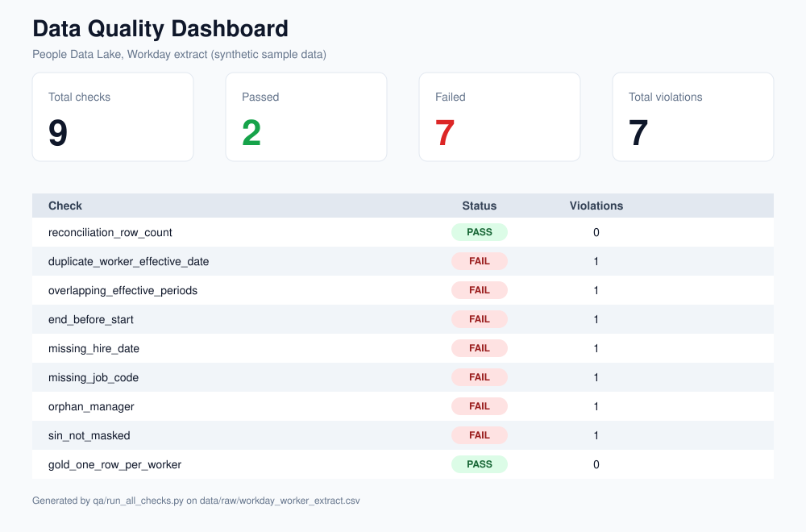

# Data Quality Checks for People Data Lake

A data quality framework for People (HR) data that flows from Workday into a data lake. The project checks that data stays accurate, complete, and reliable across the Bronze, Silver, and Gold layers, and saves the results as CSV files.

> This project works only with **synthetic data**. Do not commit real employee data to the repository.

## What It Does

1. Reads a Workday extract and loads it into three layers:
   - **Bronze:** raw data, unchanged
   - **Silver:** typed data (dates and text)
   - **Gold:** the latest state of each worker (one row per worker)
2. Runs 9 data quality checks on these layers.
3. Saves each check result (PASS or FAIL), the number of violations, and sample rows to `qa/results/`.

## Checks

| Check | What it verifies |
|---|---|
| `reconciliation_row_count` | Bronze and Silver have the same number of rows |
| `duplicate_worker_effective_date` | A worker has no more than one record for the same effective date |
| `overlapping_effective_periods` | A worker's effective periods do not overlap |
| `end_before_start` | No end date comes before its start date |
| `missing_hire_date` | Hire date is not empty |
| `missing_job_code` | Job code is not empty |
| `orphan_manager` | Every manager ID exists as a worker in the file |
| `sin_not_masked` | Social Insurance Numbers are masked as `***-***-NNN` |
| `gold_one_row_per_worker` | Gold has exactly one row per worker |

## Project Structure

```
data-quality-checks-for-people-data-lake/
├── data/
│   ├── raw/                  # Synthetic Workday extract
│   └── README.md             # Intentional defects in the sample data
├── docs/
│   ├── source_to_target.md   # Field mapping from Workday to each layer
│   ├── business_rules.md     # Business rules and effective dating
│   ├── qa_playbook.md        # Test process and triage guide
│   └── defect_log.md         # Defect tracking
├── qa/
│   ├── checks.py             # Data quality check definitions
│   ├── run_all_checks.py     # Entry point to run all checks
│   └── results/              # CSV output (not tracked by git)
├── src/
│   ├── config.py             # Paths and settings
│   └── pipeline.py           # Builds the Bronze, Silver, and Gold layers
├── tests/
│   ├── conftest.py
│   └── test_checks.py        # Tests for the checks
├── .github/workflows/ci.yml  # Runs tests and checks on every push
├── requirements.txt
├── SETUP.md                  # Setup guide
└── README.md
```

## Setup

See `SETUP.md` for the full guide. In short:

```bash
python -m venv .venv
source .venv/bin/activate        # Windows: .venv\Scripts\Activate.ps1
pip install -r requirements.txt
```

## Running

Run all checks on the sample data:

```bash
python -m qa.run_all_checks
```

To fail with exit code 1 when any check fails (for use in a real pipeline):

```bash
python -m qa.run_all_checks --strict
```

Run the tests:

```bash
pytest tests/ -v
```

## Sample Results

On the sample file, 7 checks FAIL and 2 PASS. Each FAIL matches an intentional defect in `data/raw/workday_worker_extract.csv`. Details are in `data/README.md`.

## Dashboard Preview



## Next Steps

- Power BI dashboard on the CSV results in `qa/results/`
- Freshness and volume checks
- Connection to Microsoft Fabric Lakehouse or Databricks
- Scheduling with Airflow
